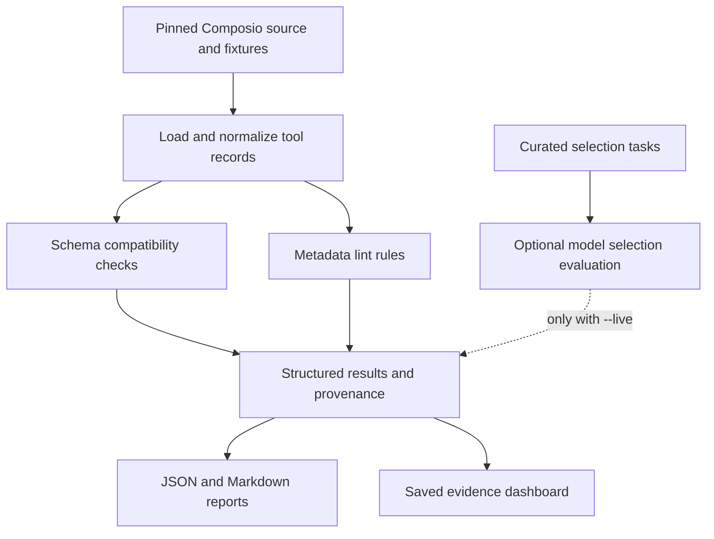

# Tool-Schema Doctor

> **A reproducible QA report for Composio tool definitions.** This project checks how tool schemas behave when passed through Composio's real provider adapters, finds metadata issues, and presents the evidence in a dashboard.

[Open the live report](https://tool-schema-doctor.netlify.app) · [CLI guide](tool-schema-doctor/README.md) · [Investigation notes](docs/milestone-0-validation.md) · [Attribution](NOTICE.md)

---

## The project in one minute

Composio exposes tools to AI models. Each tool has a JSON Schema describing its inputs. Providers such as OpenAI, Anthropic, and Google accept different schema shapes, and adapters translate Composio's definition into each provider's format. During that translation a schema can fail, or details such as `enum` constraints can disappear without an error.

I investigated those behaviors against a pinned Composio source revision, then built **Tool-Schema Doctor** to turn the investigation into repeatable checks, regression tests, reports, and a browsable dashboard.

| Question | What this project does |
|---|---|
| Will a tool schema convert for a provider? | Runs it through the provider adapter and records success, transformation, failure, or unavailable SDK. |
| Does conversion keep the useful schema details? | Compares schema keywords before and after conversion and records dropped or added keywords. |
| Is the tool metadata useful and safe to select? | Applies deterministic checks for action hints, duplicate names, and description quality. |
| Can a model choose the intended tool from similar candidates? | Optionally evaluates selection on a small, hand-curated dataset; it never executes the chosen tool. |

## What I built

The work moved from investigation to a usable QA tool in stages:

| Stage | Work completed | Result |
|---|---|---|
| 1. Investigate | Inspected Composio's provider adapters, schema handling, metadata tags, and available offline fixtures. | A set of claims to verify, with source paths and known limits. |
| 2. Reproduce | Ran schemas through installed provider adapters and checked metadata across the fixture data. | Concrete failures and transformations, rather than assumptions based on provider documentation. |
| 3. Package | Built a Python CLI with input loading, compatibility checks, metadata linting, and JSON/Markdown reporting. | Repeatable checks that can be run on the supplied fixtures or other compatible JSON inputs. |
| 4. Guard and test | Reused the real adapters, blocked network access in compatibility checks, prevented tool execution, and added regression tests for reproduced issues. | The checks examine conversion behavior without calling provider APIs or performing tool actions. |
| 5. Evaluate selection | Added an optional 27-task tool-selection evaluation with offline dataset validation and opt-in live model runs. | A way to inspect selection behavior separately from schema compatibility. |
| 6. Present evidence | Saved command output, provenance, and test results; built Streamlit and static versions of the dashboard. | Findings can be explored and traced back to evidence. |

## End-to-end flow

This is the path from source data to the report a reader sees:



| Step | What happens |
|---|---|
| **1. Input** | The CLI reads one of Composio's JSON fixture formats and normalizes tools into a common record shape. |
| **2. Compatibility** | Each tool schema is passed to the installed Composio adapter for each selected provider. The checker captures exceptions per tool so one failure does not stop the run. |
| **3. Transformation tracking** | A successful conversion is compared with the original schema. The report can distinguish a clean conversion from one that silently drops tracked keywords. |
| **4. Metadata lint** | Deterministic rules inspect descriptions, action-hint tags, and display names. Findings include the affected tool and a suggested fix. |
| **5. Optional evaluation** | The eval harness asks a model to choose among candidate tools. Without `--live`, it only validates the dataset; with `--live`, it calls the configured model and validates the returned slug. It does not execute any tool. |
| **6. Evidence and output** | Results include input provenance, adapter outcomes, raw errors, and test status. They can be read as JSON/Markdown or explored in the dashboard. |

### What the result labels mean

| Status | Meaning |
|---|---|
| `ok` | The adapter converted the schema without a tracked keyword change. |
| `transformed` | Conversion completed, but tracked schema keywords were added or dropped. |
| `error` | The adapter raised an error for this tool schema. |
| `unavailable` | The provider SDK or adapter dependency is not installed, so that provider was skipped. |
| `skipped` | This check does not apply to the input, for example compatibility against a catalog with no schemas. |

## Findings from the analyzed snapshot

The table below records the initial analysis of Composio commit [`6aa3f31`](https://github.com/ComposioHQ/composio/commit/6aa3f31ecf38fc5f9ea10d67e31a43ede2e2c693) and the adapter versions used for that run. The online dashboard displays the commit and adapter versions for its latest refresh.

| Check | Observed result | How to read it |
|---|---:|---|
| Vertex (`composio_google`) conversion | **6 failures / 930 tools** | Five rejected nested `examples`; one rejected `file_uploadable`. This baseline issue was fixed upstream in [PR #4751](https://github.com/ComposioHQ/composio/pull/4751). The online refresh checks the current source snapshot and installed adapter versions. |
| OpenAI strict schema conversion | **114 unsupported / 930** | The strict-schema utility marked 114 schemas unsupported; this is different from a provider API call or a live model test. |
| Gemini (`composio_gemini`) conversion | **1 failure / 930** | The failing tool contains a nested object schema. Successful conversions also dropped `enum` on 179 of the 182 tools that used it. |
| Missing action hints | **227 / 930 (24.4%)** | These tools in the CLI mock have none of the checked action-hint tags. |
| Duplicate display-name groups | **285 groups** | Same-name tools within a toolkit in the documentation catalog; names are not unique slugs. |

### Keep the two data sources separate

| Fixture | Size and contents | Checks it supports |
|---|---|---|
| CLI mock: `ts/packages/cli/test/__mocks__/tools.json` | **930 tools**, including schemas and tags; GitHub-heavy. | Provider compatibility, schema transformations, and action-hint checks. |
| Docs catalog: `docs/public/data/toolkits.json` | **84,004 tools** with names and descriptions, but no schemas or tags. | Display-name and description checks only. |

Counts from these two sources have different denominators and must not be combined. The figures above describe the initial checked-in snapshots, **not the live Composio catalog**. The online dashboard refreshes when the monitored upstream commit changes; each refresh records its snapshot and adapter versions. Results also depend on those adapter and SDK versions. See [`tool-schema-doctor/out/evidence/upstream_status.json`](tool-schema-doctor/out/evidence/upstream_status.json) for historical status notes and sources.

## Explore the dashboard

The [live dashboard](https://tool-schema-doctor.netlify.app) is built from saved evidence. A reader can start with the summary, open a finding, inspect affected tools and raw conversion errors, follow the link to the pinned upstream code, and see the exact reproduction command and related regression tests.

The same evidence is available in two forms:

| Version | Best for | How it is served |
|---|---|---|
| Static site in `site/` | Public hosting, including Netlify or Vercel. | HTML and JavaScript; no Python server at runtime. |
| Streamlit app | Local exploration or Streamlit hosting. | A running Python server reads the saved evidence. |

## Run it yourself

### 1. Set up the dashboard

Python 3.10 or newer is required. From the repository root:

```bash
python -m venv .venv
```

Activate it, then install the small dashboard dependencies and start the app:

```bash
python -m pip install -r requirements.txt
python -m streamlit run tool-schema-doctor/streamlit_app.py
```

PowerShell activation: `.venv\Scripts\Activate.ps1`. macOS/Linux activation: `source .venv/bin/activate`.

### 2. Set up the CLI and reproduce checks

The CLI's fixture-based examples need a Composio checkout at the analyzed revision. Clone it next to this project as `composio-upstream/`:

```bash
git clone https://github.com/ComposioHQ/composio.git composio-upstream
git -C composio-upstream checkout 6aa3f31ecf38fc5f9ea10d67e31a43ede2e2c693
```

Install the CLI, all provider adapters, and development/dashboard extras:

```bash
python -m pip install -e "tool-schema-doctor[all,dev,dashboard]"
```

Provider SDKs are optional extras. You can install only the adapters you need, such as `tool-schema-doctor[openai,anthropic]`; missing SDKs are reported as unavailable rather than schema errors.

### 3. Run useful commands

| Goal | Command |
|---|---|
| Inspect a fixture | `tool-schema-doctor inspect --input composio-upstream/ts/packages/cli/test/__mocks__/tools.json` |
| Check provider compatibility | `tool-schema-doctor compatibility --input composio-upstream/ts/packages/cli/test/__mocks__/tools.json -o out/compat.json` |
| Generate a combined report | `tool-schema-doctor report --input composio-upstream/ts/packages/cli/test/__mocks__/tools.json -o out/report` |
| Lint the large names/descriptions catalog | `tool-schema-doctor report --input composio-upstream/docs/public/data/toolkits.json --no-compat -o out/report-catalog` |
| Validate selection tasks offline | `tool-schema-doctor eval` |
| Run an opt-in live selection evaluation | `tool-schema-doctor eval --live --model openai/gpt-oss-20b -o out/eval_report.json` |

The live evaluation requires `GROQ_API_KEY` in the environment. The key is not stored by the project. Compatibility checks and linting need no API keys and make no network calls. For all CLI options and lint rules, see the [CLI guide](tool-schema-doctor/README.md).

To regenerate the saved evidence used by the dashboard, run `python tool-schema-doctor/make_evidence.py` after installing the provider and development extras. To rebuild the static site from that evidence, run `python tool-schema-doctor/build_static.py`; it writes to `site/`.

## Keep the online report current

The GitHub Actions workflow at `.github/workflows/refresh-composio-snapshot.yml` checks Composio's `next` branch every six hours. When it sees a new upstream commit, it checks out the updated fixtures, reruns the compatibility and lint reports plus the regression tests, rebuilds the static dashboard, commits the refreshed evidence to this repository, and deploys it to Netlify. Use **Actions → Refresh Composio snapshot → Run workflow** to request an immediate refresh.

Because this project does not control Composio's GitHub webhooks, updates are polled rather than instant. Netlify publishing requires a `NETLIFY_AUTH_TOKEN` secret in this repository's GitHub Actions settings. The workflow stops before publishing and reports a clear error if that secret is missing. The dashboard records the analyzed Composio commit and installed adapter versions so each refresh remains traceable.

## Tests and reproducibility

Regression tests cover the reproduced adapter failures, metadata rules, input formats, CLI behavior, and selection-evaluation data. Run them from the project root after installing the `dev` extra:

```bash
python -m pytest tool-schema-doctor/tests
```

The generated evidence directory records the commands and versions behind the dashboard results. Changing the fixtures or installed adapters can change the results; rerun `make_evidence.py` to produce a new evidence set.

## Project map

| Path | Contents |
|---|---|
| `tool-schema-doctor/src/tool_schema_doctor/` | CLI implementation: loader, adapters, compatibility checks, lint, reports, and selection evaluation. |
| `tool-schema-doctor/tests/` | Unit and regression tests. |
| `tool-schema-doctor/out/evidence/` | Saved findings, provenance, and test results used by the dashboard. |
| `tool-schema-doctor/streamlit_app.py` | Streamlit dashboard. |
| `tool-schema-doctor/build_static.py`, `site/` | Static-site builder and generated website. |
| `docs/` | Investigation validation, architecture, decisions, progress, and demo notes. |
| `investigation/` | Original investigation scripts and raw outputs. |
| `NOTICE.md` | Upstream source, fixture, and attribution details. |

## Scope and safety

- Compatibility and lint checks run offline, reuse installed Composio adapter code, and block tool execution.
- The optional live evaluation sends candidate tool slugs and descriptions to a model only when run with `--live`; it only asks for a selection.
- The 930-tool fixture is GitHub-heavy, while the 84,004-tool catalog lacks schemas and tags. Neither is a complete live snapshot.
- The 27-task selection evaluation is hand-curated and model/prompt-dependent; it is a prototype evaluation, not a general benchmark.
- This is an independent project and is not affiliated with or endorsed by Composio. The upstream checkout is referenced at a pinned commit, not vendored; see [`NOTICE.md`](NOTICE.md).
